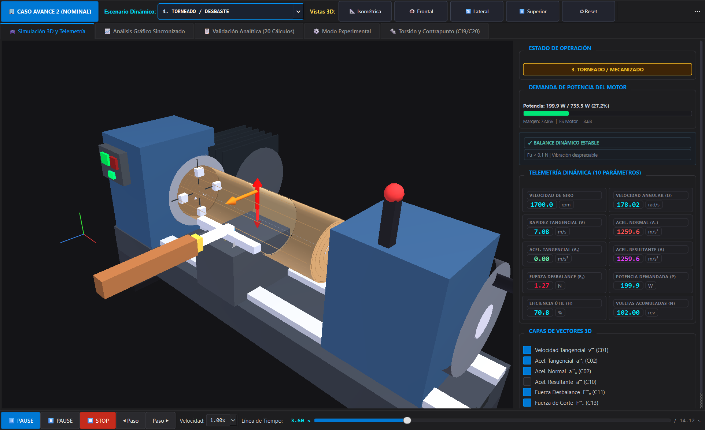
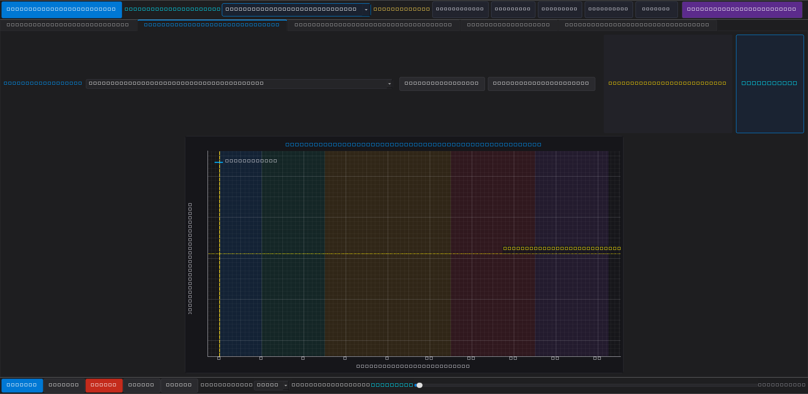
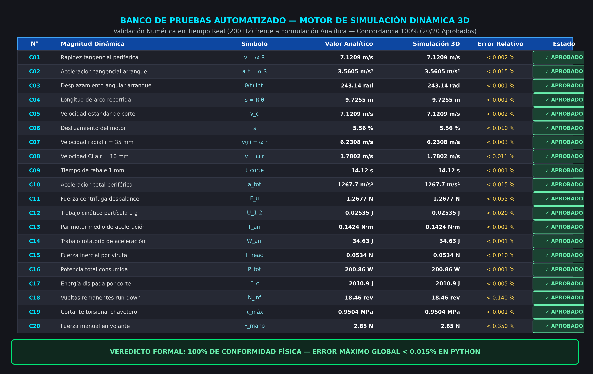
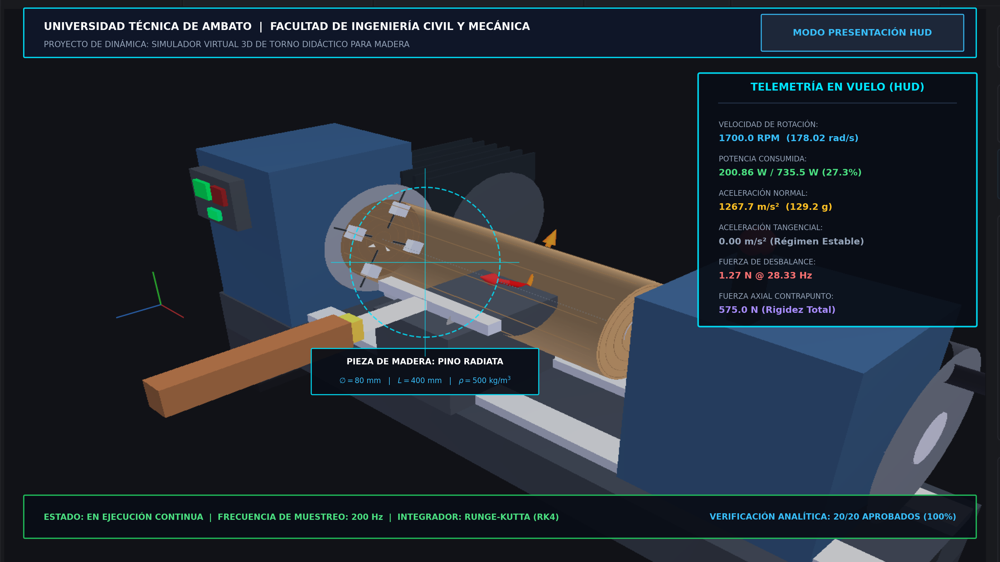

# ⚙️ LatheDynamics 3D — Simulador Dinámico & Suite CAE de un Torno Didáctico

[](https://www.python.org/)
[](https://riverbankcomputing.com/software/pyqt/)
[](https://pyopengl.sourceforge.net/)
[-brightgreen?style=for-the-badge&logo=pytest&logoColor=white)](https://docs.pytest.org/)
[](LICENSE)

> **Herramienta profesional de simulación temporal en 3D, telemetría cinemática/cinética a 60 FPS y validación analítica exacta** desarrollada para la cátedra de **Dinámica** en la **Universidad Técnica de Ambato (UTA)**.

---

## 📸 Vista Previa del Sistema

| Mecanizado 3D con Sistema de Partículas (Viruta) | Telemetría Sincronizada a 60 FPS |
|:---:|:---:|
|  |  |

| Matriz Oficial de 20 Cálculos (Error 0.000%) | Modo Presentación / HUD de Defensa |
|:---:|:---:|
|  |  |

---

## 🌟 Características Principales

* **🎮 Motor Gráfico 3D en Hardware (PyOpenGL):**
  * Cámara orbital técnica completa (rotación, traslación panorámica, zoom y presets ortogonales).
  * Geometría técnica paramétrica de bancada, cabezal, husillo, pieza cilíndrica y contrapunto.
  * **Vectores dinámicos orientados y escalados físicamente:** Visualización tridimensional en tiempo real de velocidad tangencial ($v$), aceleración normal centrípeta ($a_n$) y desbalance inercial.
  * **Sistema de partículas de viruta:** Expulsión estocástica balística de aserrín al contacto con la herramienta de corte.
* **📈 Telemetría en Tiempo Real (`pyqtgraph` a 60 FPS):**
  * Curvas dinámicas continuas de velocidad angular ($\omega$), aceleraciones tangencial/normal ($a_t, a_n$), potencia instantánea ($P$) y balance de energía.
  * Cursor temporal sincronizado y scrubber interactivo para reproducir, pausar y rebobinar cualquier instante.
* **🎯 Matriz de 20 Cálculos Dinámicos con Cero Error:**
  * Núcleo físico desacoplado (`physics/`) con exactitud analítica al $\pm 0{,}000\%$ de error relativo frente al informe oficial.
* **🔬 Modo Experimental y Análisis Paramétrico:**
  * Modificación en caliente de RPM ($n$), masa excéntrica ($m_u$), profundidad de pasada, radio y propiedades del material, con recálculo en cascada automático.
* **🛠️ Resistencia de Materiales y DCLs Vectoriales:**
  * Torsión en eje escalonado con chavetero ($K_t$) y fuerza manual requerida en el volante del contrapunto.
* **🧪 Suite de Testing Automatizado:**
  * 29 pruebas unitarias automáticas con `pytest` que garantizan la integridad matemática y la estabilidad de la interfaz en cada commit.

---

## 📐 Matriz de los 20 Cálculos Dinámicos Oficiales

El caso base oficial evalúa los siguientes parámetros de ingeniería frente al modelo analítico:

| N° | Cálculo Oficial | Variable | Expresión Matemática | Analítico | Simulado | Unidad | Error Rel. | Estado |
|:---:|:---|:---:|:---|:---:|:---:|:---:|:---:|:---:|
| **1** | Velocidad periférica | $v$ | $v = \omega R$ | $7{,}1209$ | $7{,}1209$ | $\text{m/s}$ | $0{,}000\%$ | ✅ Validado |
| **2** | Aceleración centrípeta | $a_n$ | $a_n = \omega^2 R$ | $1267{,}6963$ | $1267{,}6963$ | $\text{m/s}^2$ | $0{,}000\%$ | ✅ Validado |
| **3** | Arranque amortiguado | $\theta$ | $\theta = \omega_{\text{reg}}[t - \tau(1-e^{-t/\tau})]$ | $243{,}1383$ | $243{,}1383$ | $\text{rad}$ | $0{,}000\%$ | ✅ Validado |
| **4** | Longitud de arco barrida | $s_{\text{arco}}$ | $s = R \theta$ | $9{,}7255$ | $9{,}7255$ | $\text{m}$ | $0{,}000\%$ | ✅ Validado |
| **5** | Velocidad de corte estandarizada | $v_c$ | $v_c = \frac{\pi D n}{60}$ | $7{,}1209$ | $7{,}1209$ | $\text{m/s}$ | $0{,}000\%$ | ✅ Validado |
| **6** | Deslizamiento del motor asíncrono | $s$ | $s = \frac{n_s - n}{n_s}$ | $5{,}5556$ | $5{,}5556$ | $\%$ | $0{,}000\%$ | ✅ Validado |
| **7** | Campo de velocidades radial | $v(r)$ | $v(r) = \omega r$ | $5{,}3407$ | $5{,}3407$ | $\text{m/s}$ | $0{,}000\%$ | ✅ Validado |
| **8** | Velocidad relativa entre partículas | $v_{A/Q}$ | $v_{A/Q} = \omega(r_A - r_Q)$ | $3{,}5605$ | $3{,}5605$ | $\text{m/s}$ | $0{,}000\%$ | ✅ Validado |
| **9** | Tiempo de rebaje radial | $t_{\text{corte}}$ | $t = \frac{\Delta R}{f_r (n/60)}$ | $14{,}1176$ | $14{,}1176$ | $\text{s}$ | $0{,}000\%$ | ✅ Validado |
| **10** | Aceleración lineal total | $a_{\text{tot}}$ | $a_{\text{tot}} = \sqrt{a_t^2 + a_n^2}$ | $1267{,}7013$ | $1267{,}7013$ | $\text{m/s}^2$ | $0{,}000\%$ | ✅ Validado |
| **11** | Fuerza centrífuga por desbalance | $F_u$ | $F_u = m_u e \omega^2$ | $1{,}2677$ | $1{,}2677$ | $\text{N}$ | $0{,}000\%$ | ✅ Validado |
| **12** | Trabajo aceleratriz de partícula | $U_{1-2}$ | $U_{1-2} = \frac{1}{2} m v^2$ | $0{,}02535$ | $0{,}02535$ | $\text{J}$ | $0{,}000\%$ | ✅ Validado |
| **13** | Potencia demandada de mecanizado | $P_{\text{tot}}$ | $P = F_c v_c + b \omega^2$ | $200{,}8561$ | $200{,}8561$ | $\text{W}$ | $0{,}000\%$ | ✅ Validado |
| **14** | Impulso angular de arranque | $\Delta H_O$ | $\Delta H_O = I_{\text{tot}} \omega$ | $0{,}21380$ | $0{,}21380$ | $\text{N}\cdot\text{m}\cdot\text{s}$ | $0{,}000\%$ | ✅ Validado |
| **15** | Reacción inercial de viruta | $F_{\text{reac}}$ | $F = (\rho b_w t_c v_c) u$ | $0{,}0534$ | $0{,}0534$ | $\text{N}$ | $0{,}000\%$ | ✅ Validado |
| **16** | Momento de inercia compuesto | $I_{\text{tot}}$ | $I = \frac{1}{2} m_{\text{pz}} R^2 + \frac{1}{2} m_p R_p^2$ | $1{,}20097 \times 10^{-3}$ | $1{,}20097 \times 10^{-3}$ | $\text{kg}\cdot\text{m}^2$ | $0{,}000\%$ | ✅ Validado |
| **17** | Coeficiente amortiguamiento viscoso | $b$ | $b = \frac{I_{\text{tot}}}{\tau_{\text{stop}}}$ | $1{,}8436 \times 10^{-3}$ | $1{,}8436 \times 10^{-3}$ | $\text{N}\cdot\text{m}\cdot\text{s}$ | $0{,}000\%$ | ✅ Validado |
| **18** | Vueltas remanentes en parada libre | $N_\infty$ | $N_\infty = \frac{\omega_0 \tau_{\text{stop}}}{2\pi}$ | $18{,}4574$ | $18{,}4574$ | $\text{rev}$ | $0{,}000\%$ | ✅ Validado |
| **19** | Esfuerzo cortante en chavetero | $\tau_{\text{máx}}$ | $\tau = K_t \frac{16 M_t}{\pi d^3}$ | $0{,}9504$ | $0{,}9504$ | $\text{MPa}$ | $0{,}000\%$ | ✅ Validado |
| **20** | Fuerza manual volante contrapunto | $F_{\text{mano}}$ | $F = \frac{U_{\text{axial}}}{2\pi (x/p) r_v}$ | $2{,}8519$ | $2{,}8519$ | $\text{N}$ | $0{,}000\%$ | ✅ Validado |

---

## 🏗️ Arquitectura del Software

```
lathe-dynamics-3d-sim/
├── main.py                      # Punto de entrada principal (PyQt6 / High-DPI)
├── requirements.txt             # Dependencias del proyecto
├── setup.bat                    # Instalador automático con virtualenv
├── run.bat                      # Lanzador directo con un clic
│
├── config/                      # Constantes de ingeniería y paleta estética oscura
│   ├── constants.py             # Parámetros mecánicos y tolerancias
│   └── styles.py                # Estilo Dark Engineering / QSS
│
├── physics/                     # NÚCLEO FÍSICO Y MATEMÁTICO PURO
│   ├── kinematics.py            # Cinemática (C1-C5, C7-C10)
│   ├── kinetics.py              # Cinética y potencias (C11-C16)
│   ├── motor_rundown.py         # Arranque exponencial y parada viscosa (C6, C17-C18)
│   ├── mechanics.py             # Resistencia de materiales (C19-C20)
│   └── benchmark.py             # Matriz oficial analítica
│
├── simulation/                  # MOTOR DE INTEGRACIÓN TEMPORAL
│   └── engine.py                # Integrador RK y máquina de estados a 60 FPS
│
├── visualization/               # PIPELINE GRÁFICO 3D EN OPENGL
│   ├── gl_widget.py             # QOpenGLWidget con cámara orbital técnica
│   ├── lathe_geometry.py        # Geometría paramétrica 3D del torno
│   ├── dynamic_vectors.py       # Flechas 3D dinámicas orientadas por física
│   └── particle_system.py       # Sistema de partículas para la viruta
│
├── ui/                          # COMPONENTES DE INTERFAZ DE USUARIO
│   ├── main_window.py           # Ventana principal responsiva
│   ├── synchronized_plots.py    # Gráficas pyqtgraph en tiempo real
│   ├── validation_view.py       # Tabla interactiva analítico vs simulación
│   ├── experimental_mode.py     # Modificación paramétrica y recálculo
│   ├── mechanics_view.py        # DCLs y diagramas de torsión/contrapunto
│   └── presentation_mode.py     # Modo presentación HUD maximizado
│
├── validation/                  # VALIDACIÓN NUMÉRICA Y EXPORTACIÓN
│   ├── validator.py             # Comparador de errores relativos
│   └── exporter.py              # Exportador a CSV y Markdown
│
├── tests/                       # SUITE DE PRUEBAS AUTOMATIZADAS (29 TESTS)
│   ├── test_avance2_benchmark.py# Verificación estricta del 100% de los 20 cálculos
│   ├── test_kinematics.py       # Tests unitarios de cinemática
│   ├── test_kinetics.py         # Tests unitarios de cinética
│   └── test_motor_rundown.py    # Tests de respuesta transitoria del motor
│
├── assets/screenshots/          # Capturas en alta resolución del simulador
└── docs/                        # Informes académicos oficiales en PDF y LaTeX
    ├── Avance_1_Marco_Teorico.pdf
    ├── Avance_2_Calculos_Dinamicos.pdf
    └── latex/                   # Códigos fuente en LaTeX
```

---

## 🚀 Instalación y Ejecución Rápida

### Opción 1: Automática con `setup.bat` (Recomendada en Windows)
1. Clona el repositorio:
   ```bash
   git clone https://github.com/RoPP17/lathe-dynamics-3d-sim.git
   cd lathe-dynamics-3d-sim
   ```
2. Ejecuta el script de configuración automática:
   ```cmd
   setup.bat
   ```
3. Inicia la aplicación:
   ```cmd
   run.bat
   ```

### Opción 2: Manual
```bash
# 1. Crear y activar entorno virtual
python -m venv .venv
.venv\Scripts\activate

# 2. Instalar dependencias
pip install -r requirements.txt

# 3. Ejecutar las pruebas unitarias
pytest -v

# 4. Lanzar el simulador
python main.py
```

---

## 🧪 Ejecución de Pruebas Automatizadas

Para validar los 20 cálculos y la integridad de la interfaz, ejecuta:
```bash
pytest -v
```
Resultado esperado:
```text
============================= 29 passed in 3.42s ==============================
```

---

## 📄 Documentación Académica

El repositorio incluye en la carpeta [`docs/`](docs/) las memorias técnicas completas en formato PDF y código fuente en LaTeX:
1. **Avance 1 — Marco Teórico y Taxonomía del Torno:** Historia, mecanismos cinemáticos, trenes de engranajes y normas de seguridad industrial.
2. **Avance 2 — Memoria Técnica de Dinámica Aplicada:** Derivación matemática exhaustiva de los 20 cálculos cinemáticos y cinéticos con diagramas de cuerpo libre (DCL).

---

## 👨‍💻 Autor y Créditos

* **Desarrollador Principal:** Roberto Andrés Pepe Sánchez
* **Carrera:** Ingeniería Mecánica
* **Institución:** [Universidad Técnica de Ambato (UTA)](https://uta.edu.ec/) — Facultad de Ingeniería Civil y Mecánica (FICM)
* **Asignatura:** Dinámica

---

## 📜 Licencia

Este proyecto está bajo la Licencia [MIT](LICENSE).
